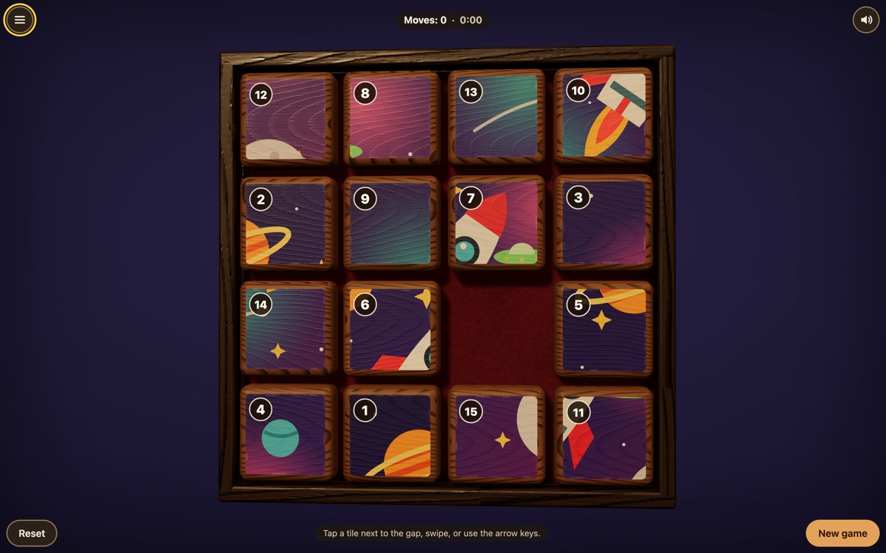
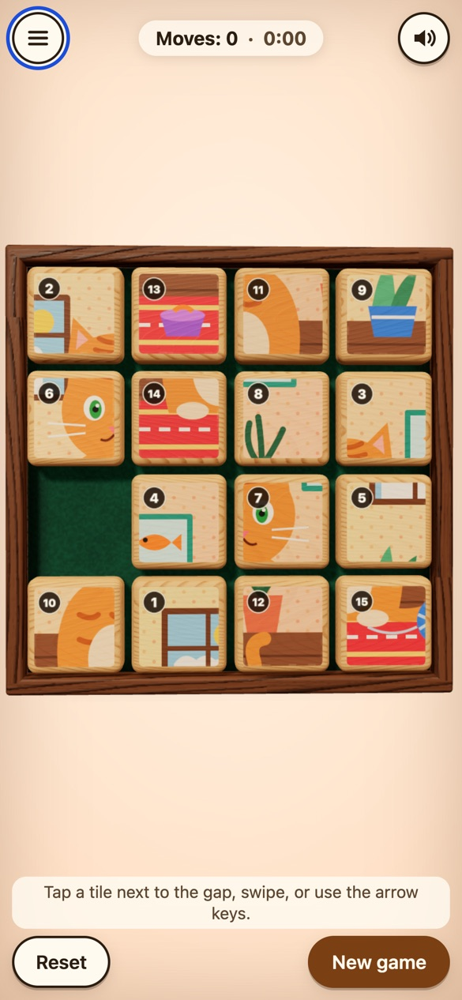
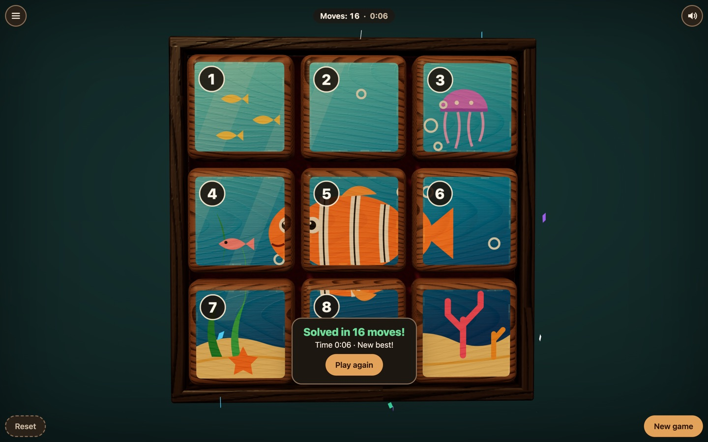
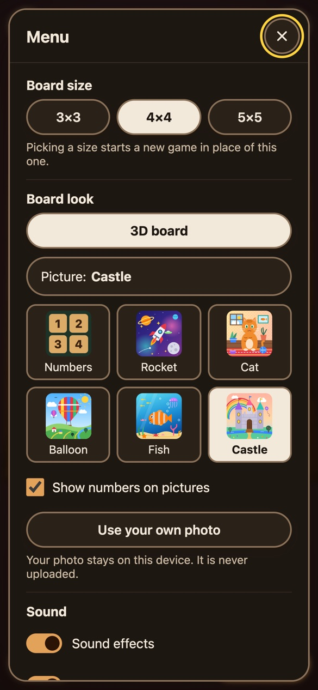

# Sliding Puzzle

A wooden 3D sliding puzzle (3×3, 4×4 or 5×5) with pictures, sound and music. Open it and you are
playing: the backend saves your game under a nickname, and the nickname is in the URL, so the link
resumes it in any browser. There is no authentication.

Play it: <https://ciunkos.com/sliding-puzzle>

| Desktop                                   | Phone                                                                  |
| ----------------------------------------- | ---------------------------------------------------------------------- |
|  |  |
|   |         |

More: [numbers](docs/numbers-light.jpg), [light theme](docs/desktop-light.jpg),
[phone, dark](docs/phone-dark.jpg).

## Playing

- **Moving.** Tap or drag a tile next to the gap. A dragged tile follows your finger and moves
  once it has travelled about a third of a cell; a quick flick is enough. Drag a tile further along
  the gap's row or column and the whole line between it and the gap is pushed at once. Swipes, the
  arrow keys and WASD work too.
- **The menu** (top left): the profile (switch to another nickname, a new random one, copy the
  link), the board size (3×3, 4×4, 5×5), the board's look (numbers, pictures, your own photo,
  numbers on pictures, the 3D board, tilt on phones), sound effects and music, your best results
  on this size, and usage statistics.
- **Sound.** The speaker in the top-right corner mutes everything; the menu switches sound effects
  and music on their own.
- **Offline.** After the first visit the game opens and plays without a network. Moves made offline
  are saved when you are back.
- **Installing.** The browser can install it as an app (Add to Home Screen on a phone). When a new
  version has been deployed, the app says "A new version is ready" and switches only when you press
  Reload.
- **Your photo** stays on your device. It is never uploaded.
- **`?fps`** at the end of the address shows frames per second, frame times and the 3D board's
  quality level in a corner, for the whole visit.

### Usage statistics

On `ciunkos.com` only, the game counts visits, installs, new games and solved games (board size,
moves, time), skin changes and sound switched on or off, through PostHog. It never sends your
nickname, board or photo: every web address leaves the page without its profile path. Events go
through a proxy on the same site, and the SDK is a pinned copy checked by its integrity hash. No
cookies, no autocapture, no session recording, no error reports. Nothing is counted when you switch
"Usage statistics" off in the menu, when the browser sends Do Not Track or Global Privacy Control,
or when automation drives the browser.

### Identity without authentication

- A profile lives at `/sliding-puzzle/p/<nickname>`. Opening that URL plays as that profile and
  creates it on first use (`POST /sliding-puzzle/api/profiles` is get-or-create). Sharing the link,
  or editing the name in the address bar, is how you "log in"; anyone with the link can play.
- A first visit to `/sliding-puzzle` generates a nickname such as `tortoise-squirrel-123` (two words
  from `src/profile/words.ts` and a number 100-999) and replaces the URL with its profile path.
- The last profile is remembered in this browser (localStorage), so `/sliding-puzzle` later goes
  straight back to it.
- Nicknames are case-insensitive and the server keeps the first casing it saw. Once a profile loads,
  the URL is replaced with that canonical casing, so one profile has one URL.
- A name that breaks the rules (`src/profile/index.ts`), including malformed percent-encoding,
  shows a "cannot be used" screen whose one action is a new random profile; nothing is created for it.
- The pure parts (paths, the start decision, name generation) are in `src/profile/url.ts` and
  `generate.ts`; the hooks only touch `history`, `location` and storage.

It runs locally on Node and SQLite and is built to deploy to Cloudflare Workers and D1.

## Run it

Needs Node 26 (see `.nvmrc`).

```sh
npm install     # also enables the git hooks
npm run dev     # API on :8787, web on :5173
```

## Commands

| Command                  | What it does                                                                                                           |
| ------------------------ | ---------------------------------------------------------------------------------------------------------------------- |
| `npm run check`          | Format, lint, types, unit and property tests, gate tests, computed checks, build                                       |
| `npm run test:e2e`       | Playwright against the real servers, in four projects: phone, desktop, app (the built app), worker (Worker + local D1) |
| `npm run test:e2e:nogpu` | The same, with WebGL drawn in software, as on the GPU-less CI runners                                                  |
| `npm run mutate`         | Mutation testing: changes the code and checks that a test notices                                                      |
| `npm run verify`         | Builds the app, plays the critical flow on a phone viewport, a screenshot per step in `verify-out/`                    |
| `npm run lighthouse`     | Builds the app and runs Lighthouse five times (mobile); fails when a median misses its threshold                       |
| `npm run dev`            | API and web together; Ctrl-C stops both                                                                                |
| `npm run format`         | Prettier                                                                                                               |

The Worker commands (`worker:dev`, `worker:check`, `deploy`) are in [DEPLOY.md](DEPLOY.md).

Scoped tests: `node --import ./scripts/tsx-hooks.js --test src/puzzle`.

Lint is [oxlint](https://oxc.rs) with type information (oxlint-tsgolint). `oxlint.config.ts` lists
every rule one by one: ESLint's recommended rules and typescript-eslint's strict and stylistic
type-checked presets, with their options. The module boundaries and the test standard are local
plugins in `lint/` (unit tests in `lint/rules.test.js`, gate tests in `gates/`). Types are checked
by TypeScript 7 (`tsc`), and `scripts/tsx-hooks.js` lets Node load `.tsx` through oxc-transform.

## Architecture

A modular monolith: one package, flat folders in `src/`, cut by what they do.

```
src/
  db/        Db port, node:sqlite driver, Cloudflare D1 driver, migrator    foundation
  profile/   nickname profiles                                              foundation
  game/      generic game engine: saved game per profile, versions,         foundation
             start / resume / move / reset. Knows no particular game.
  puzzle/    the sliding puzzle: rules, shuffle, board view. A FEATURE.
  server/    composition root: wires features into the Hono app (Node and Worker entries)
  web/       composition root: wires features into the React shell
  test-support/  literal board grids, the real in-memory database, small test fixtures
migrations/  plain SQL, applied locally by our migrator and on D1 by wrangler
e2e/         Playwright acceptance tests
gates/       tests of the quality gates themselves
scripts/     computed checks and the TSX loader
```

### The deletion test

A feature is a good module if you can delete its folder, remove the lines that pin it, and the
project still compiles. `scripts/check-deletion.js` does exactly that for every feature, on every
run of `npm run check`.

- Foundations never import a feature. A feature plugs into the engine through a `GameDefinition`
  (`start`, `apply`, `isFinished`, and zod schemas for its state, moves and options).
- Only `src/server/features.ts` and `src/web/features.tsx` import features, and each such line
  ends with `// pin: <folder>`.

### Adding a game

1. Create `src/<name>/` with a `definition.ts`, a `server.ts` exporting a `ServerFeature` and a
   `client.tsx` exporting a `ClientFeature` (see `src/puzzle/`).
2. Pin it in `src/server/features.ts` and `src/web/features.tsx`.
3. `npm run check`. The deletion test now covers your folder too.

### Module rules (enforced by lint in `oxlint.config.ts`, tested in `gates/boundaries.test.ts`)

- Import another module only through its `index.ts`, `server.ts` or `client.tsx`.
- Server code never imports client code, and the reverse.
- `puzzle/rules.ts`, `shuffle.ts` and `rng.ts` are pure: no imports outside the folder.
- Only `src/server` supplies randomness and time. Modules take them as required options.

### Saved games

The server is authoritative. The browser sends a move together with the version it was made on.
If the stored game has moved on, the server answers `409 stale` with the current game and the
browser adopts it. Signing in is one atomic "resume" call that returns the saved game or creates it.

## Tests

The standard is in `AGENTS.md` and is enforced by lint (`lint/test-standard.js`), so a test that
breaks it cannot be committed:

- A test sits next to the file it covers and reads in ten seconds: one behaviour, Given / When / Then.
- Expected values are written by hand. Boards are drawn with the `grid` tag.
- No branching or loops in tests; many inputs means a fast-check property.
- No fakes of our own modules: tests use the real in-memory SQLite, and the D1 driver is tested
  against a real local D1.

End-to-end tests are few, long and deep: each one plays on from where its last step left the
player, with `test.step` for each stage, so one browser session checks a lot.

- `e2e/journey.spec.ts` is the core scenario. A player arrives, plays (tap, drag, keys), comes
  back (refresh, new tab, another browser), wins, picks a picture and 3D, goes offline and back,
  and opts out of usage statistics. It runs on a phone with touch and on a desktop with a mouse.
- The other specs are auxiliary flows, one file per area, each with one to four tests:
  - `moving`: every way a hand can move tiles, or must not;
  - `look`, `sound`, `profiles` (with the menu and axe), `layout` (one page resized through every
    screen), `smoothness` (render counts), `offline` (saving);
  - `app`: the installed build with its service worker;
  - `worker`: the deploy rehearsal on the Worker and D1.

`npm run mutate` shows whether the tests can fail. `gates/hooks.test.ts` shows that the git hooks
refuse a bad commit or push.

## Working in this repo

Read `AGENTS.md`. It is short, and it applies to people and coding agents alike.
